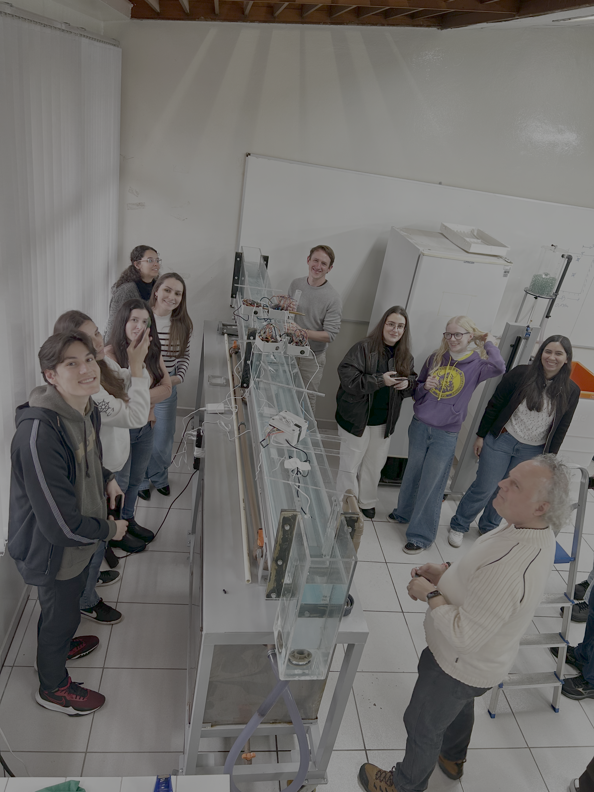

# Aula 08 - Condutivímetro, temperatura e MQTT (salinidade em canal)

Nessa aula será refeito o experimento da pluma de salinidade em canal d'água no laboratório. 
Serão usados sensores de temperatura e condutividade e os microcontroladores ESPs enviarão os dados via MQTT para um Gateway (Raspberry).

A proposta é variar a inclinação do canal para verificar a influência no coeficiente de dispersão $D_L$. 

//
Canal, sensores, professores e discentes realizando as medições
